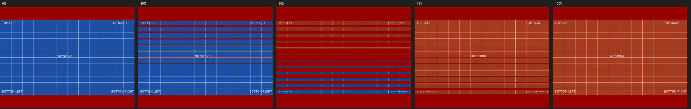
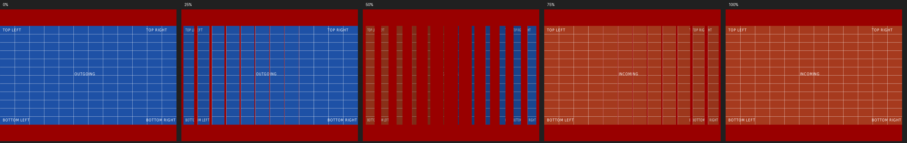
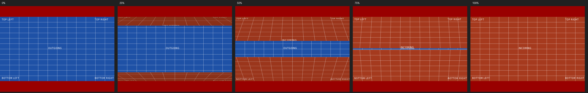
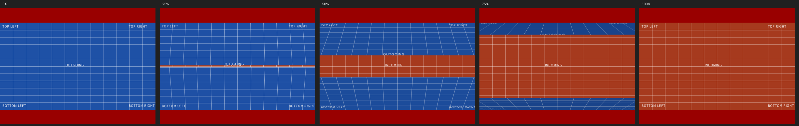
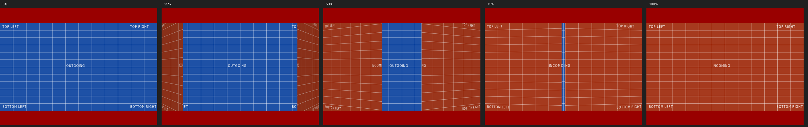
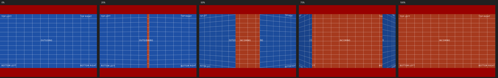
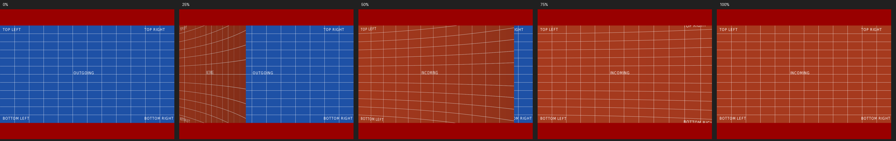
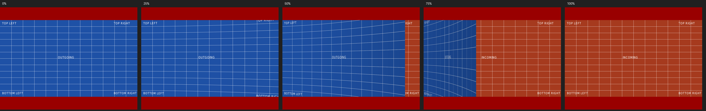
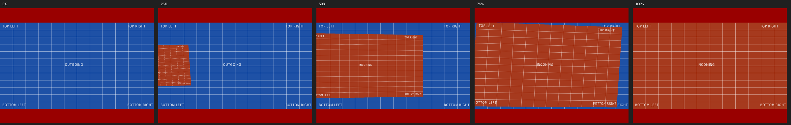
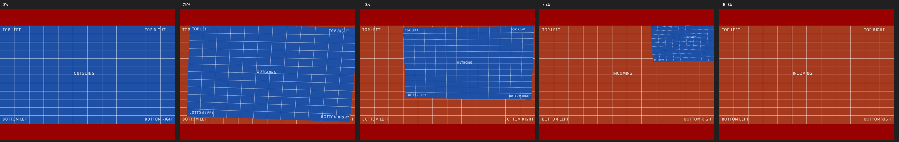

# Transition roadmap and review gallery

Each effect starts from freshly fetched origin/master on its own branch.
Rebase before handoff. Effects advance from experimental, through visual
review, to accepted; a passing build is not visual approval.

| Order | Effect | Interpretation | Acceptance focus |
| --- | --- | --- | --- |
| 1 | Blinds | Twelve rotating louvers, cascading across the page | Both axes, readable reverse faces, seamless endpoints |
| 2 | Split | Perspective double doors on fixed outer hinges | Both axes, opening/closing, seamless endpoints |
| 3 | Cover / Uncover | Flexible page flips | Curvature, correct front/back mapping |
| 4 | Fly | A page drifting like a leaf on a controlled gust | Direction, scale, readable flight, controlled landing |
| 5 | Push | Cube pushes a soft cube | Deterministic contact and recovery |
| 6 | Dissolve / Glitter | Textured particles / flare and sparks | Stable randomness, bounded memory and brightness |
| 7 | Wipe / Fade / Replace | Physical wiper / crossfade / instant | Direction, clean endpoints |

Box keeps the classic cube. Unsupported PDF effects currently replace the page.
Future effects must preserve document ratio, prepare full-resolution source
images before motion, and finish on the exact static destination image.
Geometry is a function of progress, never an uncontrolled physics simulation.

## Blinds: experimental, awaiting visual approval

Try the committed [horizontal](../../examples/transitions/blinds-horizontal.pdf)
and [vertical](../../examples/transitions/blinds-vertical.pdf) PDFs in PDFCube;
press Space to advance. [Example instructions](../../examples/transitions/README.md)
include the regeneration command.

Candidate captures from the software renderer, at 0%, 25%, 50%, 75%, and 100%:





Horizontal and vertical PDF Blinds are interpreted as a cascade of twelve
rotating slats. The old page appears on the front; the new page appears on the
reverse without mirrored lettering. A restrained angular shade suggests depth.
This first version uses thin surfaces, without cast shadows or physical thickness.
Different page ratios retain independent fitting; visible background between
slats is intentional.

Space, Page Down, and automatic advance read the destination page's PDF
transition. Explicit cube/instant keys keep their existing meaning.
PDF /Trans /D is animation duration (including fractions); /Dur is page dwell
time. Missing dwell time does not auto-advance. This corrects the previous
conflation of those fields. Nonpositive animation duration means instant change.
Existing --program duration:c and duration:p remain supported; duration:blinds
selects Blinds with the existing 750 ms programmed animation duration.

## Split: experimental, awaiting visual approval

Split uses two rigid, thin doors with perspective and restrained angular shading.
PDF `/Dm /V` selects left/right doors; `/Dm /H` selects top/bottom flaps.
`/M /O` opens the outgoing slide to reveal the destination; `/M /I` closes the
incoming slide over the old one. The outer edges are fixed hinges. Motion eases
in and out, ending edge-on when open, without mirrored text or a camera jump.
There is no physical thickness or cast shadow. Doors are clipped to their page;
different page ratios are independently fitted, never stretched.

Try all four [committed example PDFs](../../examples/transitions/README.md).
These captures use the same generated PDFs as the tests and review videos:









The PDF animation duration is respected. `--program duration:split` selects
Split with a 750 ms animation, using the destination PDF's axis and direction
(PDF defaults: horizontal, inward). Explicit cube and instant keys are unchanged.
Both full-resolution pages are prepared before the animation clock starts.
At 0% and 100% the renderer draws the exact static source/destination page.

## Cover / Uncover: experimental, awaiting visual approval

Cover folds a gently curved incoming sheet over the old slide. Uncover peels the
outgoing sheet away to reveal the next slide. Unlike Split's two rigid doors,
this is one connected sheet with a fixed outer edge, perspective and angular
shading. Sixty-four joined strips approximate the curve with constant arc length;
there is no physics simulation, cast shadow, thickness, or mirrored reverse face.
The sheet stops edge-on, rather than turning its back toward the audience.

| PDF `/Di` | Travel | Cover hinge | Uncover hinge |
| --- | --- | --- | --- |
| 0 (default) | Right | Left | Right |
| 90 | Up | Bottom | Top |
| 180 | Left | Right | Left |
| 270 | Down | Top | Bottom |

Unsupported angles fall back to 0. The destination PDF's `/Trans /D` controls
duration; `/Dur` remains dwell time. `--program duration:cover` and
`duration:uncover` select a 750 ms animation with the PDF direction. Existing
cube/instant navigation is unchanged. Full-resolution source and destination
pages are ready before motion, with their own aspect ratios and exact static
endpoints. Moving geometry stays inside its page viewport.

All eight [example PDFs](../../examples/transitions/README.md) use the same
generator as the tests and gallery. Representative captures:





Other Cover directions: [up](cover-up.png), [left](cover-left.png),
[down](cover-down.png). Other Uncover directions: [right](uncover-right.png),
[up](uncover-up.png), [down](uncover-down.png).
Each direction also has a video in the generated review bundle.

## Fly: experimental, awaiting visual approval

Fly treats the moving page as a light sheet caught by a controlled gust. It
follows a shallow 3D arc, banks into its path, adds one small deterministic
flutter, then progressively loses both motions and lands exactly flat. Incoming
(`/M /I`) pages travel from beyond the opposite edge in the PDF `/Di` direction;
outgoing (`/M /O`) pages leave in that direction. Arbitrary angles are supported,
including the eight compass directions used by the examples.

`/SS` sets the off-screen start/end scale; valid values are greater than zero
and at most one, with invalid values conservatively treated as one. `/B` metadata
is retained. PDF pages are rendered against their normal opaque white page
background, so `/B` does not erase actual page artwork. The moving page may pass
through the letterbox area, but its aspect ratio never changes. Both pages are
prepared at full output resolution before the animation clock starts, and the
static endpoints bypass animated geometry.

The [eight example PDFs](../../examples/transitions/README.md) alternate inward
and outward motion while covering every 45-degree direction. Representative
captures:





The other six direction captures and all eight videos are in the same gallery.
`--program duration:fly` uses the destination PDF's direction, scale and motion
with the normal 750 ms programmed duration. Explicit cube and instant keys are
unchanged.

## Reproduce the review bundle

Install Pillow and ffmpeg in addition to the normal build/test dependencies:

```sh
meson setup build -Dwerror=true
meson compile -C build
meson test -C build --print-errorlogs
python3 tools/transition_gallery.py build/src/pdfcube build/transition-gallery
```

Add `--update-docs` to regenerate the checked-in contact sheets from those same
captures. The default 33 samples include exact quarter-progress frames.
Use `--effects Cover Uncover` for a focused page-flip review; CI captures all
implemented effects by default. Gallery capture reuses one Xvfb display and
captures up to four frames concurrently. Use `--jobs N` to tune that limit for
the available CPU and memory; this does not change the generated frames.

Open build/transition-gallery/index.html. Each effect/axis/direction has a looping video,
five-frame contact sheet, full-resolution individual frames, and its input PDF.
The manifest records the source revision and binary version. Rebuild first;
captures must come from the revision under review. CI uploads this bundle on
every pull request. Download and unzip it to view locally.

Candidate captures are never automatically promoted to golden references.
The reviewer checks framing, direction, readability, motion and final alignment,
then records approval with the commit and platform. Subsequent effects use this
same process and add their own fixtures and gallery entry.

## Validation record

Blinds, Split, Cover/Uncover and Fly: Ubuntu 24.04, GTK 4.14.5, Poppler 24.02,
Xvfb/software OpenGL. All sixteen tests passed with warnings treated as errors,
both normally and with address/undefined-behavior sanitizers.
The horizontal and vertical contact sheets were inspected for direction and
readable reverse faces. Page-flip captures were inspected for curvature,
direction and readable text; a Split midpoint still matched the previous
capture byte-for-byte. Fly contact sheets were inspected for direction,
readable text, restrained
flutter and a flat landing. This is not yet native-platform or motion approval.

- Automated: PDF metadata (fractional animation duration distinct from dwell),
  both axes, portrait/landscape/mixed dimensions, deterministic midpoint,
  byte-identical start/end renders compared with static pages.
- Split: fixed hinges and edge-on finish, reversible monotonic geometry,
  both directions, default PDF parameters, program selection, and reproducible
  committed PDFs. The gallery includes all four Split parameter combinations.
- Existing cube, zoom, document resolution, CLI and navigation tests remain required.
- Cover/Uncover checks cover connected curvature, reversible geometry, fixed
  hinges, unmirrored flat UV mapping, edge-on finish, all four PDF directions,
  omitted/invalid angle fallback, program selection and reproducible example PDFs.
- Fly checks cover all eight compass directions, inward/outward reversibility,
  bounded height and monotonic landing, `/SS` validation, PDF metadata, program
  selection, deterministic rendering, exact endpoints and reproducible examples.
- Pending manual approval: realistic Beamer deck; HD/2K/4K frame-time measurements;
  native Wayland/NVIDIA, X11, Windows and macOS playback; long-running playback
  memory checks. Still-frame and geometry checks are not substitutes for these.
- Captures use software OpenGL; they do not establish hardware performance.

For every new effect, add parameter/default/invalid-value coverage, sampled
geometry and image checks, repeated-playback memory checks, and a review bundle.
Record renderer, resolution, duration and frame-time distribution for performance
reviews; do not infer a performance pass from still-image tests.
