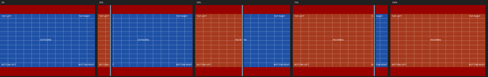
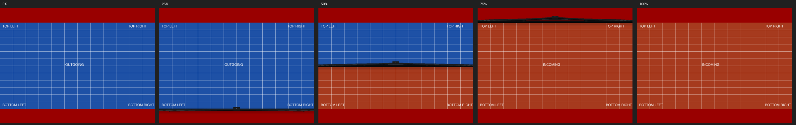
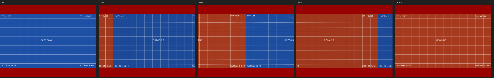
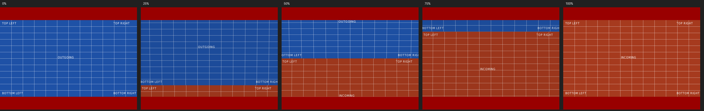
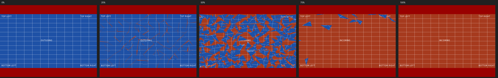
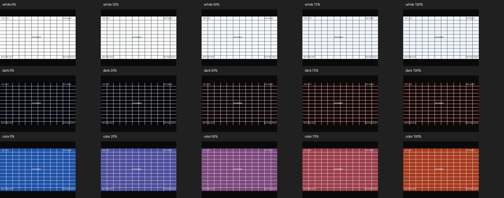

# Transition roadmap and review gallery

Each effect starts from freshly fetched origin/master on its own branch.
Rebase before handoff. Effects advance from experimental, through visual
review, to accepted; a passing build is not visual approval.

| Order | Effect | Interpretation | Acceptance focus |
| --- | --- | --- | --- |
| 1 | Blinds | Twelve rotating louvers, cascading across the page | Both axes, readable reverse faces, seamless endpoints |
| 2 | Split | Perspective double doors on fixed outer hinges | Both axes, opening/closing, seamless endpoints |
| 3 | Cover / Uncover | Flexible page flips | Curvature, correct front/back mapping |
| 4 | Fly | A page drifting like a leaf on a controlled gust | Direction, scale, readable flight, controlled landing |
| 5 | Push | Cube pushes a soft cube | Deterministic contact and recovery |
| 6 | Dissolve / Glitter | Glass shatter / flare and sparks | Stable geometry, bounded memory and brightness |
| 7 | Wipe | Raised physical wiper sweeping the outgoing image away | Four directions, exact reveal mask and endpoints |
| 8 | Fade / Replace | Crossfade (next) / instant (already available) | Clean endpoints |

Box keeps the classic cube. Unsupported PDF effects currently replace the page.
Future effects must preserve document ratio, prepare full-resolution source
images before motion, and finish on the exact static destination image.
Geometry is a function of progress, never an uncontrolled physics simulation.

## Wipe: experimental, awaiting visual approval

A three-dimensional wiper sweeps straight across the viewport, clearing the outgoing
page and revealing the destination behind it. A rubber contact lip, bowed pressure
spine, raised brackets and metal pivot give it a mechanical silhouette. Directional
lighting shows the depth of each part. A small damped flex settles during the sweep. Beveled matte surfaces and a
soft contact shadow keep the blade grounded against the page. The pages stay flat, readable
and at full resolution. Travel eases in and out and extends beyond both edges,
so the blade enters and leaves completely. There is no simulation or accumulating
state, and no per-frame geometry allocation.

PDF `/Di` values 0, 90, 180 and 270 select right, up, left and down. Missing or
invalid angles default to right. `--program 4:wipe` uses the same effect and the
normal 750 ms programmed duration; document playback uses PDF `/Trans /D`, with
`/Dur` reserved for dwell time. Explicit cube and instant navigation are unchanged.

Each page keeps its own fitted aspect ratio. The unrevealed region includes the
outgoing letterbox, so a differently shaped incoming page cannot show through
early. The clipping edge is pixel-aligned and concealed by the blade. At 0% and
100% the renderer bypasses the wiper and draws the exact static page.

Try the [right](../../examples/transitions/wipe-right.pdf),
[up](../../examples/transitions/wipe-up.pdf), [left](../../examples/transitions/wipe-left.pdf)
and [down](../../examples/transitions/wipe-down.pdf) diagnostic PDFs, or the
[Beamer showcase](../../examples/showcase/README.md). Candidate contact sheets:





Other directions: [left](wipe-left.png), [down](wipe-down.png).
These are software-renderer candidates, not visual acceptance or hardware
performance measurements. Fade is the next unimplemented roadmap effect;
Replace already changes the page instantly.

Local Wipe captures were inspected with GTK 4.22.4, Poppler 26.01 and software
OpenGL, including a midpoint from the updated Beamer deck. All 26 Wipe cases
pass with address/undefined-behavior sanitizers. In the optimized-blade run, 12 sanitizer cases
missed the 500 ms SLO (519–661 ms); this is recorded separately from
functional correctness and does not establish a hardware performance pass.

### Wipe frame profiling

A local 1920×1080 headless run on the RTX 3060, with `glFinish` after each
frame, measured 180 frames at explicit progress values after 20 warmup frames.
The debug build changed as follows; these measurements exclude the compositor:

| Renderer | Median before → after | p95 before → after |
| --- | --- | --- |
| NVIDIA RTX 3060 | 0.65 → 0.52 ms | 0.83 → 0.80 ms |
| llvmpipe software | 10.4 → 8.1 ms | 14.1 → 12.0 ms |

The incoming page is now clipped to its revealed region, avoiding hidden-page
fragment work. Lighting is evaluated once per quad rather than once per vertex;
the optimized mesh microbenchmark improved from 0.092 to 0.055 ms per update.
A second GPU comparison measured 0.68 → 0.63 ms median but 0.90 → 1.65 ms
p95, so these samples do not establish a consistent GPU tail-latency improvement.
Cold PDF rasterization/upload remains a separate cost (190–249 ms on the GPU
runs); warmed frame throughput does not establish that first-frame latency is solved.
The RSS replay check disables ASan's freed-block quarantine only for that check,
so retained freed driver buffers do not masquerade as live memory growth. Other
sanitizer frame cases retain their ordinary quarantine.

## Glitter: experimental, awaiting visual approval

A directional front releases small textured pieces of the outgoing slide,
revealing the destination beneath. Pieces rotate, drift and fade, with small
warm sparks highlighting release and fading during flight. Alpha blending
bounds brightness; the effect uses at most 336 pieces. Motion is deterministic.
The first and last frames use the exact static page rendering path.

PDF `/Di` values 0, 270 and 315 select right, down and diagonal down-right.
Missing or invalid directions use right. `--program 4:glitter` selects the same
effect. Try the [right](../../examples/transitions/glitter-right.pdf),
[down](../../examples/transitions/glitter-down.pdf) and
[diagonal](../../examples/transitions/glitter-down-right.pdf) examples.
Rendering tests cover all directions and page ratios, including exact endpoint
images. No rendered gallery or visual approval is claimed until those checks
can run on a machine with GTK and OpenGL.

## Blinds: experimental, awaiting visual approval

Try the committed [horizontal](../../examples/transitions/blinds-horizontal.pdf)
and [vertical](../../examples/transitions/blinds-vertical.pdf) PDFs in PDFCube;
press Space to advance. [Example instructions](../../examples/transitions/README.md)
include the regeneration command.

Candidate captures from the software renderer, at 0%, 25%, 50%, 75%, and 100%:


Horizontal and vertical PDF Blinds are interpreted as a cascade of twelve
rotating slats. The old page appears on the front; the new page appears on the
reverse without mirrored lettering. A restrained angular shade suggests depth.
This first version uses thin surfaces, without cast shadows or physical thickness.
Different page ratios retain independent fitting; visible background between
slats is intentional.

Space, Page Down, and automatic advance read the destination page's PDF
transition. Explicit cube/instant keys keep their existing meaning.
PDF /Trans /D is animation duration (including fractions); /Dur is page dwell
time. Missing dwell time does not auto-advance. This corrects the previous
conflation of those fields. Nonpositive animation duration means instant change.
Existing --program duration:c and duration:p remain supported; duration:blinds
selects Blinds with the existing 750 ms programmed animation duration.

## Split: experimental, awaiting visual approval

Split uses two rigid, thin doors with perspective and restrained angular shading.
PDF `/Dm /V` selects left/right doors; `/Dm /H` selects top/bottom flaps.
`/M /O` opens the outgoing slide to reveal the destination; `/M /I` closes the
incoming slide over the old one. The outer edges are fixed hinges. Motion eases
in and out, ending edge-on when open, without mirrored text or a camera jump.
There is no physical thickness or cast shadow. Doors are clipped to their page;
different page ratios are independently fitted, never stretched.

Try all four [committed example PDFs](../../examples/transitions/README.md).
These captures use the same generated PDFs as the tests and review videos:


The PDF animation duration is respected. `--program duration:split` selects
Split with a 750 ms animation, using the destination PDF's axis and direction
(PDF defaults: horizontal, inward). Explicit cube and instant keys are unchanged.
Both full-resolution pages are prepared before the animation clock starts.
At 0% and 100% the renderer draws the exact static source/destination page.

## Cover / Uncover: experimental, awaiting visual approval

Cover folds a gently curved incoming sheet over the old slide. Uncover peels the
outgoing sheet away to reveal the next slide. Unlike Split's two rigid doors,
this is one connected sheet with a fixed outer edge, perspective and angular
shading. Sixty-four joined strips approximate the curve with constant arc length;
there is no physics simulation, cast shadow, thickness, or mirrored reverse face.
The sheet stops edge-on, rather than turning its back toward the audience.

| PDF `/Di` | Travel | Cover hinge | Uncover hinge |
| --- | --- | --- | --- |
| 0 (default) | Right | Left | Right |
| 90 | Up | Bottom | Top |
| 180 | Left | Right | Left |
| 270 | Down | Top | Bottom |

Unsupported angles fall back to 0. The destination PDF's `/Trans /D` controls
duration; `/Dur` remains dwell time. `--program duration:cover` and
`duration:uncover` select a 750 ms animation with the PDF direction. Existing
cube/instant navigation is unchanged. Full-resolution source and destination
pages are ready before motion, with their own aspect ratios and exact static
endpoints. Moving geometry stays inside its page viewport.

All eight [example PDFs](../../examples/transitions/README.md) use the same
generator as the tests and gallery. Representative captures:


Other Cover directions: [up](cover-up.png), [left](cover-left.png),
[down](cover-down.png). Other Uncover directions: [right](uncover-right.png),
[up](uncover-up.png), [down](uncover-down.png).
Each direction also has a video in the generated review bundle.

## Fly: experimental, awaiting visual approval

Fly treats the moving page as a light sheet caught by a controlled gust. It
follows a shallow 3D arc, banks into its path, adds one small deterministic
flutter, then progressively loses both motions and lands exactly flat. Incoming
(`/M /I`) pages travel from beyond the opposite edge in the PDF `/Di` direction;
outgoing (`/M /O`) pages leave in that direction. Arbitrary angles are supported,
including the eight compass directions used by the examples.

`/SS` sets the off-screen start/end scale; valid values are greater than zero
and at most one, with invalid values conservatively treated as one. `/B` metadata
is retained. PDF pages are rendered against their normal opaque white page
background, so `/B` does not erase actual page artwork. The moving page may pass
through the letterbox area, but its aspect ratio never changes. Both pages are
prepared at full output resolution before the animation clock starts, and the
static endpoints bypass animated geometry.

The [eight example PDFs](../../examples/transitions/README.md) alternate inward
and outward motion while covering every 45-degree direction. Representative
captures:


The other six direction captures and all eight videos are in the same gallery.
`--program duration:fly` uses the destination PDF's direction, scale and motion
with the normal 750 ms programmed duration. Explicit cube and instant keys are
unchanged.

## Push: experimental, awaiting visual approval

Push treats the outgoing and incoming pages as two shallow padded blocks. Their
shared contact plane travels in the PDF `/Di` direction. At impact the softer
outgoing block squashes by about ten percent along the travel axis, bulges by up
to 3.5 percent across it, and makes one small damped wobble. The firmer incoming
block yields by at most 2.5 percent. Both lift slightly toward the viewer and
recover completely before the final frame. These are closed-form easing curves,
not a free-running simulation, so replay, reverse navigation and review captures
remain deterministic.

PDF directions 0, 90, 180 and 270 select right, up, left and down. Missing or
unsupported angles use the PDF default of right. Both pages are rendered at
full output resolution before motion and retain their own fitted aspect ratios.
The 0% and 100% paths draw the exact static source and destination pages.
`--program duration:push` selects the effect with the destination PDF's
direction and the normal 750 ms programmed duration.

The four committed examples use the same generator as the tests and gallery:





Other directions: [left](push-left.png) and [down](push-down.png). All four
videos are included in the generated review bundle. `--top-color` controls the
shallow side faces as well as the classic cube caps.

## Dissolve: experimental, awaiting visual approval

Dissolve treats the outgoing page as a thin glass panel hit from behind at
its center. An irregular Voronoi partition divides the panel into 64
interlocking polygonal pieces, slightly denser around the impact. Cracks do
not follow spokes or concentric rings. Each polygon remains one rigid piece
when the GPU draws its triangle fan.

The impact cuts directly from the intact page to separated, tilted fragments;
there is no slow crack-opening stage. The blow is strongest at the center,
with a modest outward-speed taper and a stronger forward impulse toward the
viewer. Each piece retains its launch speed and then accelerates gently and
continuously, reaching 15% more speed by the end. Perspective is compensated
at the pivot so it does not add an unintended speed ramp. Every piece is
completely outside the viewport by 99%, without a late sweep, shrink, or fade.

Each piece keeps a fixed tumbling axis tangent to its flight direction and a
constant individual angular velocity. Distinct angular speeds avoid a
synchronized edge-on flash. Restrained two-sided lighting makes the rotation
readable. Perspective gives the forward-moving splinters depth without a
late speed boost. There is no gravity or camera movement. Both faces retain
the outgoing slide texture.

Pass `--experimental` to give the pieces a very thin wafer volume with two
textured faces and a pale rim, roughly two pixels thick at a 960-pixel page
width. The default keeps zero-thickness surfaces. This flag does not change
the launch timing or velocity, and `--experimental=false` disables it explicitly.

The fracture and motion are closed-form functions of progress: there is no
runtime randomness or accumulating physics state. All shard vertices are sent
in one small dynamic GPU buffer and rendered in one draw call. Both page
textures are prepared at full output resolution before motion begins. The exact
0% and 100% frames bypass the fracture mesh and draw the static source and
destination pages without cracks, seams or reduced resolution.

Try the committed [Dissolve example](../../examples/transitions/dissolve.pdf).
The image below records an earlier candidate; regenerate the review bundle
with the current renderer to review the redesigned motion:



`--program duration:dissolve` selects the effect with the normal 750 ms
programmed duration. PDF `/Trans /D` controls document-driven duration.

## Reproduce the review bundle

Install Pillow and ffmpeg in addition to the normal build/test dependencies:

```sh
meson setup build -Dwerror=true
meson compile -C build
meson test -C build --print-errorlogs
python3 tools/transition_gallery.py build/src/pdfcube build/transition-gallery
```

Add `--update-docs` to regenerate the checked-in contact sheets from those same
captures. The default 33 samples include exact quarter-progress frames.
Use `--effects Wipe` for a focused wiper review. The manual transition-review
workflow captures all implemented effects by default. Gallery capture reuses one Xvfb display and
captures up to four frames concurrently. Use `--jobs N` to tune that limit for
the available CPU and memory; this does not change the generated frames.

Open build/transition-gallery/index.html. Each effect/axis/direction has a looping video,
five-frame contact sheet, full-resolution individual frames, and its input PDF.
The manifest records the source revision and binary version. Rebuild first;
captures must come from the revision under review. The manual transition-review
workflow uploads the bundle; ordinary CI keeps only one GUI smoke capture. Download and unzip it to view locally.

Candidate captures are never automatically promoted to golden references.
The reviewer checks framing, direction, readability, motion and final alignment,
then records approval with the commit and platform. Subsequent effects use this
same process and add their own fixtures and gallery entry.

## Validation record

Blinds, Split, Cover/Uncover, Fly, Push and Dissolve: Ubuntu 24.04, GTK 4.14.5,
Poppler 24.02, Xvfb/software OpenGL. Tests pass with warnings treated as errors,
both normally and with address/undefined-behavior sanitizers.
The horizontal and vertical contact sheets were inspected for direction and
readable reverse faces. Page-flip captures were inspected for curvature,
direction and readable text; a Split midpoint still matched the previous
capture byte-for-byte. Fly contact sheets were inspected for direction,
readable text, restrained
flutter and a flat landing. This is not yet native-platform or motion approval.
Push captures were inspected for continuous contact, asymmetric squash, a
restrained settling wobble, direction and complete recovery. This is not yet
native-platform or motion approval.

- Automated: PDF metadata (fractional animation duration distinct from dwell),
  both axes, portrait/landscape/mixed dimensions, deterministic midpoint,
  byte-identical start/end renders compared with static pages.
- Split: fixed hinges and edge-on finish, reversible monotonic geometry,
  both directions, default PDF parameters, program selection, and reproducible
  committed PDFs. The gallery includes all four Split parameter combinations.
- Existing cube, zoom, document resolution, CLI and navigation tests remain required.
- Cover/Uncover checks cover connected curvature, reversible geometry, fixed
  hinges, unmirrored flat UV mapping, edge-on finish, all four PDF directions,
  omitted/invalid angle fallback, program selection and reproducible example PDFs.
- Fly checks cover all eight compass directions, inward/outward reversibility,
  bounded height and monotonic landing, `/SS` validation, PDF metadata, program
  selection, deterministic rendering, exact endpoints and reproducible examples.
- Push checks cover all four PDF directions, default/invalid direction fallback,
  monotonic contact, bounded squash/stretch/wobble, PDF metadata, program
  selection, deterministic rendering, exact endpoints and reproducible examples.
- Dissolve checks deterministic fracture geometry, bounded shard parameters,
  portrait/landscape/mixed ratios, PDF metadata, program selection, distinct
  sampled stages, exact endpoints and a reproducible example.
- Wipe checks bounded and monotonic clipping, symmetric travel, all four directions,
  omitted/invalid angle fallback, exact revealed/unrevealed pixel regions including
  mixed page letterboxes, deterministic replay, GL state cleanup, PDF metadata,
  program dispatch, complete frame sweeps, repeated-playback RSS bounds in one
  shared context, and reproducible example PDFs.
- Pending manual approval: realistic Beamer deck; HD/2K/4K frame-time measurements;
  native Wayland/NVIDIA, X11, Windows and macOS playback; long-running playback
  memory checks. Still-frame and geometry checks are not substitutes for these.
- Captures use software OpenGL; they do not establish hardware performance.

For every new effect, add parameter/default/invalid-value coverage, sampled
geometry and image checks, repeated-playback memory checks, and a review bundle.
Record renderer, resolution, duration and frame-time distribution for performance
reviews; do not infer a performance pass from still-image tests.

## Fade: experimental, awaiting visual approval

Fade exchanges light between two stationary slides. An sRGB decode, linear-light
blend, and sRGB encode keep white artwork steady and avoid a dark midpoint.
The blend weight is smoothstep (`3t² − 2t³`), with gentle starts and finishes.
Each slide retains its own fitted aspect ratio; the surrounding background is
part of each composition. Both full-resolution textures are ready before motion,
and endpoints use the exact static page path.

PDF `/S /Fade` uses `/Trans /D` for animation duration. `--program 4:fade` uses
the normal 750 ms programmed animation. Direction and axis have no effect.
Try [fade.pdf](../../examples/transitions/fade.pdf).

Candidate headless software-renderer captures (light, dark, and colored slides):



Animated previews: [light](fade-review/white.gif), [dark](fade-review/dark.gif),
[colored](fade-review/color.gif). These synthetic artwork pairs check shared
labels and brightness; photographic material still needs visual review.
Regenerate these previews with `python3 tools/fade_review.py` after building.
Tests compare rendered pixels against the sRGB transfer function at three
intermediate times, including mixed aspect ratios, and verify unchanged identical
slides, deterministic output, PDF metadata, CLI dispatch, and exact endpoints.
